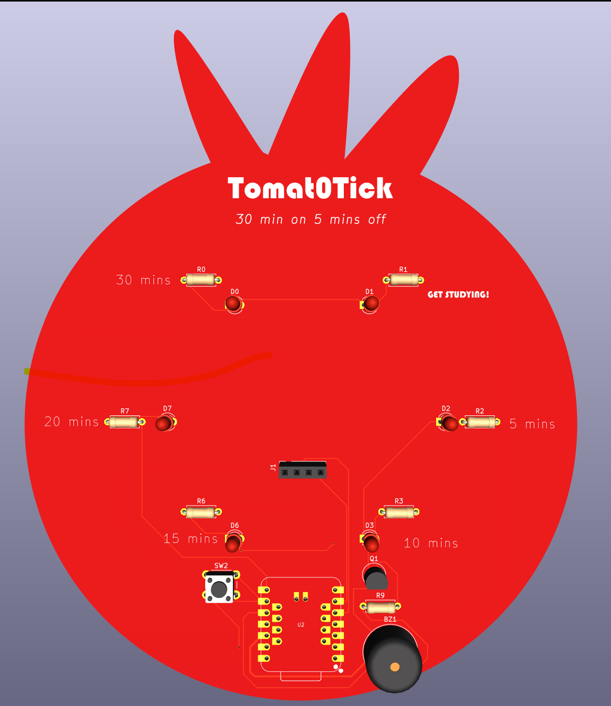
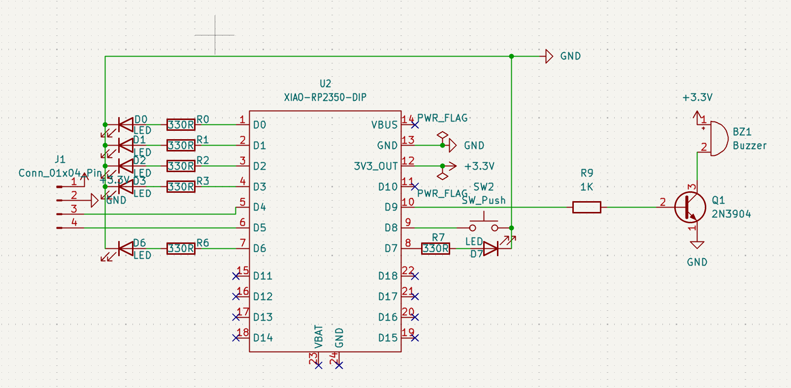

# TomatoTick 2D Pomodoro Timer PCB only 
A PCB in the shape of a Tomato that runs a pomodoro timer of 30 minutes studying and 5 minutes break on repeat.
Here is the final render of my project!!

## This project is used to have a physical timer for studying that is a physical object instead of a digital site/app. The TomatoTick is meant to exist only as a PCB for a theatrical aspect and easy build process. The microchip is a XIAO RP2350 and powers the main display of an OLED SSD1306 which repeats a 30 minutes timer and 5 minute break when started. 

* Pomodoro Timer
* Quick and Easy digital timer build
* Exam study help

## Using this repo:
1. Code is located in Tomato-Tick/Arduino
2. Gerber Files, images, schematics and pcb are located in Tomato-Tick/PCB

## heres how I made the project :)
1. Used Kicad and made a simple schematic with my parts (see BOM.csv)
2. Download all the Seeed libraries for the XIAO 2040
3. After the schematic is finished turn into PCB view and simply make a tomato shape on the edge faces layer
4. Add the traces to each component (use the render image above for reference)
5. Change the film colour to add the 'red' tomato

## Schematic of Tomato-Tick

### Bill of Materials (See BOM.cv)

| Reference | Part | Qty | Description | Vendor | Unit Price | Link |
| :--- | :--- | :---: | :--- | :--- | :---: | :--- |
| U2 | XIAO RP2350 | 1 | Microcontroller module | Seeed Studio | $5.90 | https://seeedstudio.com |
| D0 D1 D2 D3 D6 D7 | LED 3mm | 6 | Countdown LEDs | Core Electronics | $0.60 | https://core-electronics.com.au |
| R0 R1 R2 R3 R6 R7 | 330R resistor | 6 | LED current-limit resistors | Core Electronics | $1.58 | https://core-electronics.com.au |
| R9 | 1k resistor | 1 | Transistor base resistor | N/A | N/A | *Have one at home* |
| Q1 | 2N3904 transistor | 1 | NPN transistor for the buzzer | Core Electronics | $0.30 | https://core-electronics.com.au |
| SW2 | 6mm tactile button | 1 | Pause and reset button | Core Electronics | $0.36 | https://core-electronics.com.au |
| BZ1 | 5V active buzzer | 1 | Alert buzzer | Core Electronics | $0.27 | https://core-electronics.com.au |
| J1 | 1x4 pin header | 1 | OLED connector | Core Electronics | $0.11 | https://core-electronics.com.au |
| U1 | 1x7 pin header | 2 | Microcontroller connector | Core Electronics | $1.26 | https://core-electronics.com.au |
| OLED1 | White I2C OLED display (SSD1306) | 1 | 0.96in display | Core Electronics | $5.05 | https://core-electronics.com.au |

